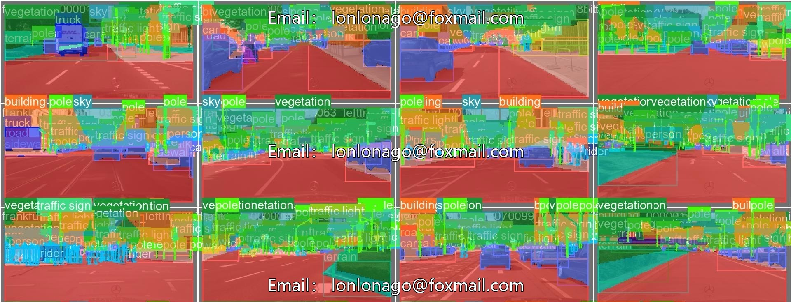
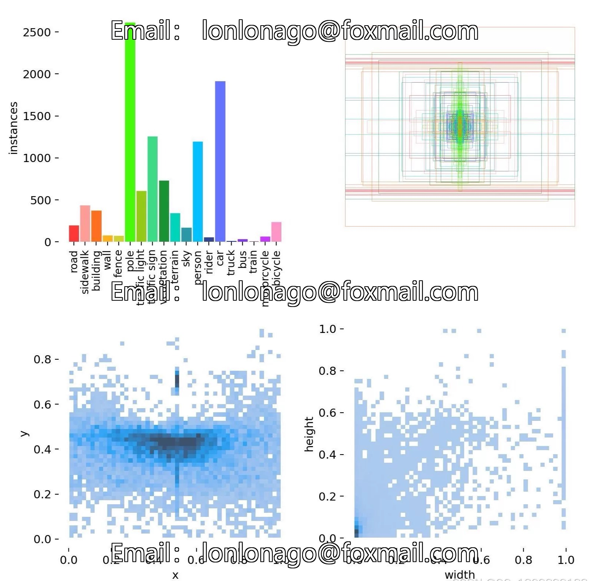
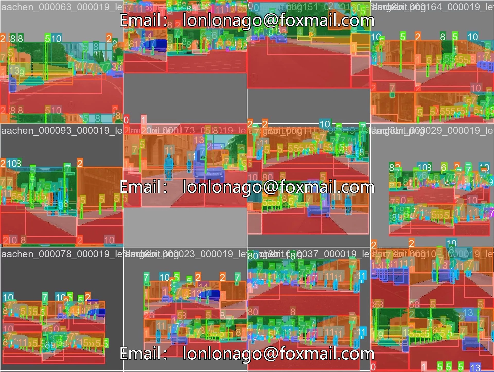

# Deep learning road obstacle image segmentation and recognition dataset, YOLOv8 on C.

## Body

Deep learning-based road obstacle image segmentation and recognition dataset, YOLOv8 in the Cityscapes urban road image segmentation project

The dataset consists of 5000 finely annotated images (2975 training, 500 validation, 1525 test), and 20000 coarsely annotated images, with 30 semantic categories (19 for evaluation). The images are high-resolution at 1024×2048 pixels, suitable for training and algorithm research of the YOLOv8 object detection model.

Dataset Characteristics
- 5000 finely annotated images (2975 training, 500 validation, 1525 test)
- 20000 coarsely annotated images
- 30 semantic categories (19 for evaluation)
- High resolution images (1024×2048 pixels)

YOLOv8 Technology Improvements
- Backbone Network Optimization: CSPDarknet53 Improved Version
- Adaptive Feature Fusion: PANet Structure Enhancement
- No-Anchors Detection: Simplifying the Detection Process
- Adjustments for Cityscapes: Input Resolution Compatibility, Class Remapping, and Optimization for Small Object Detection

Training Method
- Data Preprocessing: Typical Data Augmentation Configurations
- Format: YOLOv8 Standard Output Format

Virtual materials, once sold, are non-refundable.
Interested friends, click "I want" to proceed.

## Images

## Payment

Here is a pay link on Stripe ( https://buy.stripe.com/3cs8yP7sY87d0vu9AB ). Please contact me lonlonago@foxmail.com after funding $89, and I will send you a complete data files , thank you!

